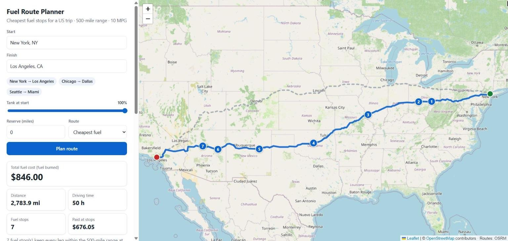
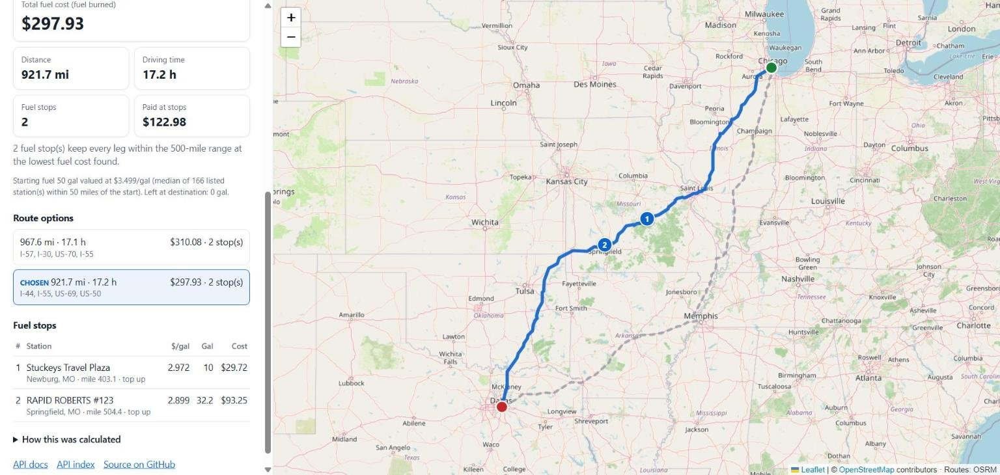
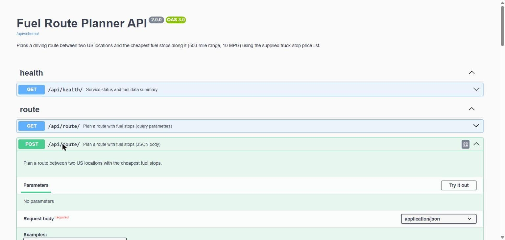
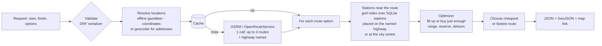

# Fuel Route Planner (Django)

[](https://github.com/apurvaraj9/fuel-route-api/actions/workflows/ci.yml)

Plan a driving route between two places in the USA and find the **cheapest fuel stops** along it for a truck with a
**500-mile range** at **10 miles per gallon**, using a list of ~6,600 truck-stop prices.

- **Web planner:** type a start and finish, see the route, the stops and the total cost on a map.
- **REST API** (Django REST Framework) with **interactive docs** (Swagger) at `/api/docs/`.
- **Django admin** to browse and edit stations and prices.



**Live demo:** <https://fuel-route-api-h6na.onrender.com/> · API docs: <https://fuel-route-api-h6na.onrender.com/api/docs/>
(free Render instance: the first request after 15 idle minutes takes about a minute while it wakes up)

Built with Django 6.1, Django REST Framework 3.18, drf-spectacular, SQLite, Leaflet + OpenStreetMap, and the free
OSRM routing service. Originally written for a backend coding assessment, then extended.

---

## What it does

| | |
|---|---|
| **Whole-trip fuel cost** | Reports the cost of all fuel burned, not just fuel bought on the way. You choose how full the tank is at the start; that fuel is valued at local prices. |
| **Smart refuelling** | At each stop it either fills up (where fuel is cheap) or buys just enough to reach the next stop (where it is expensive). This is provably optimal for stations along a line and verified against exhaustive search in the tests. Tiny top-ups are rounded up to 10 gallons where possible, so every stop is worth making. |
| **Realistic station positions** | The price list only gives a city. When a station's address names a highway the route uses (`I-44, EXIT 283`), the station is placed on that highway instead of at the city centre. |
| **Safety reserve** | Optionally never plan to have less than N miles of fuel left. |
| **Route comparison** | One routing call returns up to 3 route options; the one with the lowest total fuel cost wins (or the fastest, if you prefer). |
| **One external call per trip** | "City, ST" and coordinates are resolved offline; routes are cached, so repeats make zero calls. |
| **Protected** | Per-client rate limiting, timeouts and clear error codes for every failure. |

<table><tr>
<td></td>
<td></td>
</tr><tr>
<td align="center">Route options and fuel stops (Chicago → Dallas)</td>
<td align="center">Interactive API docs at <code>/api/docs/</code></td>
</tr></table>

---

## Quick start

### Windows (PowerShell, e.g. the VS Code terminal)

```powershell
py -3.12 -m venv .venv
.\.venv\Scripts\python.exe -m pip install -r requirements-dev.txt
Copy-Item .env.example .env
.\.venv\Scripts\python.exe manage.py migrate
.\.venv\Scripts\python.exe manage.py load_fuel_prices
.\.venv\Scripts\python.exe manage.py test
.\.venv\Scripts\python.exe manage.py runserver
```

### macOS / Linux

```bash
python3 -m venv .venv && source .venv/bin/activate
pip install -r requirements-dev.txt
cp .env.example .env
python manage.py migrate
python manage.py load_fuel_prices
python manage.py test
python manage.py runserver
```

### Docker

```bash
docker compose up --build
```

Then open <http://127.0.0.1:8000/> (planner), <http://127.0.0.1:8000/api/docs/> (API docs) or
<http://127.0.0.1:8000/admin/> (admin; create a login with `python manage.py createsuperuser`).

No API key is needed: routes come from the public OSRM server by default.

---

## API

### `GET /api/route/?start=...&finish=...` or `POST /api/route/`

```json
{
  "start": "Chicago, IL",
  "finish": "Dallas, TX",
  "start_fuel_percent": 100,
  "reserve_miles": 0,
  "route_preference": "cheapest",
  "alternatives": true
}
```

| Field | Default | Meaning |
|---|---|---|
| `start`, `finish` | required | US location: `"City, ST"`, `"latitude,longitude"` or an address |
| `start_fuel_percent` | `100` | Tank level at the start (10–100) |
| `reserve_miles` | `0` | Never plan to have less than this much range left (0–200) |
| `route_preference` | `cheapest` | `cheapest` (lowest total fuel cost) or `fastest` |
| `alternatives` | `true` | Compare alternative routes (still one routing call) |

Response (abridged; Chicago → Dallas from a test run on recorded OSRM routes):

```json
{
  "start": {"label": "Chicago, IL", "lat": 41.85, "lon": -87.678, "source": "local_gazetteer"},
  "finish": {"label": "Dallas, TX", "...": "..."},
  "route": {"provider": "osrm", "index": 1, "distance_miles": 921.7, "duration_hours": 17.2,
            "main_highways": ["I-44", "I-55", "US-69"], "stations_considered": 191, "stations_on_highway": 101},
  "alternatives": [
    {"index": 0, "chosen": false, "distance_miles": 967.6, "total_fuel_cost_usd": 310.1, "number_of_stops": 2},
    {"index": 1, "chosen": true, "distance_miles": 921.7, "total_fuel_cost_usd": 297.19, "number_of_stops": 1}
  ],
  "fuel_plan": {
    "starting_fuel": {"gallons": 50.0, "price_per_gallon": 3.499, "value_usd": 174.95,
                      "price_source": "median of 166 listed station(s) within 50 miles of the start"},
    "stops": [{"stop_number": 1, "name": "RAPID ROBERTS #123", "address": "I-44, EXIT 80", "city": "Springfield",
               "state": "MO", "price_per_gallon": 2.899, "route_mile": 499.8, "miles_since_previous_fuel": 499.8,
               "fuel_on_arrival_gallons": 0.02, "gallons_purchased": 42.168, "fill": "partial", "cost_usd": 122.24,
               "location": {"lat": 37.25, "lon": -93.293, "placement": "highway"}}],
    "purchases_usd": 122.24,
    "fuel_used_gallons": 92.168,
    "fuel_left_at_destination": {"gallons": 0.0, "value_usd": 0.0},
    "total_fuel_cost_usd": 297.19
  },
  "map": {"url": "https://.../?start=Chicago%2C+IL&finish=Dallas%2C+TX", "geojson": {"type": "FeatureCollection"}},
  "meta": {"external_api_calls": 1, "routes_compared": 2, "elapsed_ms": 56, "assumptions": ["..."]}
}
```

- **`total_fuel_cost_usd`** = starting fuel value + purchases − value of the fuel left at the destination, i.e. the cost
  of the fuel actually burned on this trip. **`purchases_usd`** is the money paid at the stops.
- `map.geojson` contains the chosen route, the other route options and every stop (paste it into
  <https://geojson.io>); `map.url` opens the same plan in the web planner.

Full, interactive documentation: **`/api/docs/`** (OpenAPI schema at `/api/schema/`).

### Other endpoints

| Endpoint | |
|---|---|
| `GET /` | Web planner |
| `GET /api/` | Endpoint index |
| `GET /api/health/` | Status and fuel-data summary (last import) |
| `/admin/` | Django admin: stations, prices, import history |

### Errors

Every error is `{"error": {"code": "...", "message": "...", "details": {...}}}`:

| Status | Code | When |
|---|---|---|
| 400 | `invalid_request` | missing/blank field, bad JSON, out-of-range option, same start and finish |
| 422 | `location_not_found` / `location_outside_usa` | location cannot be found in the USA |
| 422 | `no_route_found` | no drivable route (e.g. to Hawaii) |
| 422 | `no_feasible_fuel_plan` | no listed station within range somewhere on the route |
| 429 | `rate_limited` | too many requests from this client (`ROUTE_RATE_LIMIT`, default 30/min) |
| 502 | `upstream_error` | routing/geocoding service failed or returned bad data |
| 503 | `upstream_rate_limited` | the free routing service's rate limit was hit |
| 504 | `upstream_timeout` | routing/geocoding service timed out |
| 503 | `fuel_data_unavailable` | stations not loaded (checked before any external call) |

---

## How it works



1. **Locations**: `"City, ST"` and coordinates are resolved from `data/us_places.csv` (~39k US city centroids from
   public ZIP-code data). Only free-form addresses use a geocoder (Nominatim, or OpenRouteService with a key).
2. **Routes**: one call to OSRM (or OpenRouteService if `ORS_API_KEY` is set) returns the route options with full
   geometry and step-by-step road references (`I 80; US 6`). Cached for 24 h.
3. **Stations on the route** (`services/planner.py`): stations are loaded from the database into an in-memory grid
   index (rebuilt automatically when the table changes, e.g. after an admin edit). A station whose address names a
   highway the route uses is placed on that highway where it passes closest to the station's city (within
   `HIGHWAY_SNAP_MILES`, 20 for interstates and 10 for other roads). Otherwise the station stays at its city centre
   and must be within `ROUTE_CORRIDOR_MILES` (10); the detour there and back counts against range and fuel.
4. **Fuel plan** (`services/optimizer.py`): dynamic programming over (station, fuel on arrival). In an optimal plan
   every stop either fills the tank or buys just enough for the next leg (Khuller, Malekian & Mestre, *To fill or not
   to fill*, 2007), so fuel on arrival is either the reserve or "full tank minus the last leg": O(k) states per
   station, O(log k) per transition. A per-stop penalty (`FUEL_STOP_PENALTY_USD`, $15, never added to any reported
   cost) avoids extra stops that save only cents, and a top-up smaller than `MIN_PURCHASE_GALLONS` (10) is rounded up
   by moving fuel from the next stop (legs and final fuel unchanged, a few cents more). Infeasible routes report where
   the gap is.
5. **Route choice**: every route option gets a full plan; the cheapest total fuel cost wins (or the fastest).

A coast-to-coast request takes roughly 0.1–0.3 s of processing after the route arrives.

### Data handling

The supplied price list (`data/fuel-prices-for-be-assessment.csv`, unchanged) is loaded with
`python manage.py load_fuel_prices` (re-run it with a newer file to update prices; stations are matched by OPIS ID).

- 8,151 rows; 620 rows in Canadian provinces are excluded (trips are within the USA; those prices may use another
  currency/unit).
- 6,626 unique US stations; when an ID is listed several times with different prices, the lowest price is used.
- All 6,626 stations are matched to a city location; over 6,000 addresses name at least one highway.
- Invalid prices are skipped and counted, never guessed. Each import is recorded (see admin → Fuel price imports).

### Assumptions and limitations

- Station positions are approximate: on the named highway nearest the city, or at the city centre.
- Off-route distance is straight-line, not road distance.
- Starting fuel and fuel left at the destination are valued at local/last-paid prices (the response says which).
- Routing uses a car profile from a free public service, so availability depends on that service. OpenRouteService
  only offers alternative routes for trips under 100 km.

---

## Configuration (environment variables)

| Variable | Default | Purpose |
|---|---|---|
| `DJANGO_SECRET_KEY` | — (required unless `DJANGO_DEBUG=True`) | Django secret key |
| `DJANGO_DEBUG` | `False` | Debug mode for local development |
| `DJANGO_ALLOWED_HOSTS` | `localhost,127.0.0.1` | Comma-separated host names (Render's host is added automatically) |
| `DATABASE_PATH` | `db.sqlite3` | SQLite file location |
| `ORS_API_KEY` | empty | Use OpenRouteService instead of OSRM |
| `ROUTE_ALTERNATIVES` | `3` | Route options to request |
| `ROUTE_CORRIDOR_MILES` | `10` | Max distance of a city-placed station from the route |
| `HIGHWAY_SNAP_MILES` | `20` | Max distance from a station's city to its highway on the route |
| `FUEL_STOP_PENALTY_USD` | `15` | Per-stop penalty used only to choose the plan |
| `MIN_PURCHASE_GALLONS` | `10` | Round tiny top-ups up to this many gallons (0 = exact cheapest plan) |
| `ROUTE_RATE_LIMIT` | `30/min` | Per-client limit on `/api/route/` |
| `NUM_PROXIES` | unset | Proxies in front of the app, for correct client IPs in rate limiting |
| `HTTP_CONNECT_TIMEOUT_SECONDS` / `HTTP_READ_TIMEOUT_SECONDS` | `5` / `20` | External API timeouts |
| `HTTP_USER_AGENT` | project name + URL | Identifies the app to OSRM/Nominatim (their policies require it) |
| `DJANGO_SUPERUSER_USERNAME` / `_EMAIL` / `_PASSWORD` | unset | If all set, `build.sh` creates an admin user |

Secrets live only in `.env` (git-ignored) or the host's environment settings.

---

## Development

```bash
python manage.py test        # 78 tests
ruff check . && ruff format --check .
```

- **Tests** cover the optimizer (exact match with exhaustive search on 250 random instances, plus invariants with
  detours and reserves), highway parsing, CSV import and updates, the station index, location parsing, both routing
  clients (alternatives, failures, timeouts, rate limits, caching), the API end to end (route choice, options,
  validation, throttling, errors), the web page, API docs and admin. External services are never called: routing
  responses are **real routes recorded from OSRM** (`routeplanner/tests/fixtures`).
- **CI** (GitHub Actions) runs lint, Django checks, migration and OpenAPI checks, the tests, and builds and
  smoke-tests the Docker image on every push.

### Project layout

```
config/                      settings, URLs, WSGI
routeplanner/
  models.py                  FuelStation, FuelPriceImport
  admin.py                   Django admin
  serializers.py             request validation + response docs
  views.py  api.py           API views, error format
  services/
    data.py                  price list parsing, gazetteer, station index
    highways.py              highway name parsing (addresses and route steps)
    geocoding.py             start/finish -> coordinates
    routing.py               OSRM / OpenRouteService client (1 call, cached)
    geo.py                   distances, polylines, route matching
    optimizer.py             fuel-stop dynamic programming
    planner.py               puts it together, chooses the route, builds the response
  templates/routeplanner/planner.html   web planner (Leaflet)
  management/commands/       load_fuel_prices, build_places
  tests/
data/                        supplied price list (unchanged) + US city centroids
docs/postman_collection.json
Dockerfile  docker-compose.yml  build.sh  render.yaml  .github/workflows/ci.yml
```

## Deploying (Render free web service)

1. In Render: **New → Web Service**, connect the repository, choose the **Free** instance type, and set:
   - Build command: `bash build.sh`
   - Start command: `gunicorn config.wsgi --workers 2 --preload --timeout 60 --bind 0.0.0.0:$PORT`
   - Health check path: `/api/health/`
   - Environment: `DJANGO_SECRET_KEY` (generate), `DJANGO_DEBUG=False`, `PYTHON_VERSION=3.12.3`; optionally the
     three `DJANGO_SUPERUSER_*` variables for an admin login, and `ORS_API_KEY`.
2. `render.yaml` contains the same settings as a Blueprint.

The database is built from the CSV during each deploy. On Render's free plan the disk is not persistent, so edits made
in the admin last until the next deploy or restart; reload a new price list by committing it and redeploying.

## Attribution

Routes © OSRM / OpenRouteService, map data © OpenStreetMap contributors (ODbL).
City centroids derived from public US ZIP-code data (`zipcodes` package).
